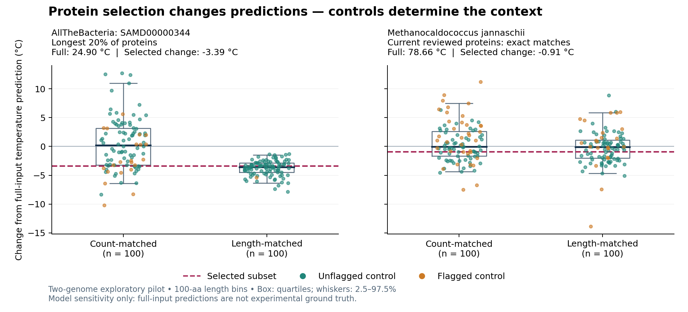

# Pilot results — 17 October 2026

**Executed:** the official GenomeSPOT example, 17 automated tests (including
full/subset parity with the upstream implementation), and 404 model evaluations
over two real genome inputs. The official example reproduced its reference
temperature optimum of 22.953768 °C and oxygen class probability of 0.974255.

## AllTheBacteria download and inference pilot

Input: the sample `SAMD00000344` used in the official ATB download example.
Its 2,344 proteins were called with Pyrodigal 3.6.3. This is a convenient
pipeline test, not a randomly sampled or quality-screened population study.
Species and habitat metadata have not been validated for this sample.

Selecting the 468 longest proteins changed the predicted temperature optimum
from 24.90 to 21.51 °C (−3.39 °C). The shift lies within the length-matched
control envelope (−6.56 to −1.43 °C). It therefore does not provide evidence
for an additional effect beyond the length-selected comparison in this example.
The count-matched envelope was much wider (−7.38 to +11.71 °C), illustrating
why control choice matters. These are descriptive envelopes, not a formal test.
Oxygen tolerance probability stayed high: 0.9983 to 0.9993.

## Archaeome-linked source organism

Input: *Methanocaldococcus jannaschii* DSM 2661, assembly
`GCF_000091665.1`, corresponding RefSeq protein file, and the current UniProt
reviewed query for taxon 243232. This organism appears in the paper's
Supplementary Data 2. No historical archaeome input release was reconstructed.

Of 1,786 current reviewed protein records, 1,177 matched uniquely by exact
full-length sequence to 1,811 RefSeq proteins. The 609 unmatched records
remain unresolved; selected inputs are thus a **mapped subset of current
reviewed proteins**, not all reviewed proteins. Mapping attrition is a potential
selection bias and disqualifies this example from the proposed high-coverage
primary cohort until resolved.

Predicted optimum temperature changed from 78.66 to 77.75 °C (−0.91 °C),
within both matched control envelopes. Oxygen predictions were strongly
not-tolerant but carried an upstream novelty flag. Oxygen class confidence
does not cancel that warning. Salinity was also flagged for the full and
selected inputs. No measured physiology or independent accuracy test was used.

## What this establishes

The workflow works on an ATB assembly and an archaeome-linked genome, retains
warnings, and exposes accession/mapping problems. The pilot **does not establish
systematic selection bias, evolutionary adaptation, causal gene effects, a
new physiology discovery, or paper readiness**. A null or modest cohort-wide
effect would still be an informative benchmark if rigorously evaluated.

Full per-run outputs, protein IDs, model hashes and data-source URLs are in
[`examples/`](../examples/). Raw input sequences are downloaded by the pilot
script and excluded from Git. Each control type has 100 replicates, seed 23,
and length matching uses 100-amino-acid bins. Missing/flagged counts are shown
in the individual reports. Later source-database releases may change results.
