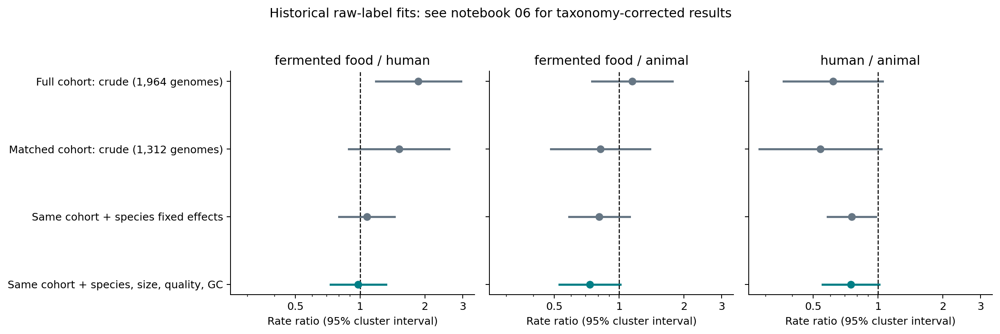

# Historical raw-label comparison: see the corrected extension

**Correction, 21 October 2026:** the original comparisons below pooled 20
unresolved `s__` genomes across six genera. Those species-control inferences are
superseded by [the taxonomy-corrected extension](robustness-results-2026-10-21.md)
and notebook 06. The corrected joint food/human estimate is 1.02 (0.75–1.39).
The source registry and original fits remain unchanged for audit.

The crude fermented-food versus human-associated difference in predicted AMP
counts is **not robust to species and genome covariates** in this reanalysis.
This is useful evidence for the ecology/evolution question; it does not
establish that ecology has no influence, or invalidate the source paper.

## Data integrity and endpoint

We reanalyzed the original supplementary tables of
[Du et al. (2025)](https://doi.org/10.1186/s40168-025-02145-3). Their Methods use
Macrel on small ORFs, a different endpoint from APEX fragments inside reviewed
archaeal proteins. The data are an independent methodological comparison, not
temperature replication. Article/supplement data are CC BY 4.0.

Exact joins recover all 1,964 screened MAGs, 1,327 candidate records, 880 positive
and 1,084 zero-hit genomes. S4/S5 positive tables match in every shared field;
genome/species/habitat joins are exact. The complete registry supplies genuine
zeros. Source ZIP, hashes and all analysis inputs are public.

| Habitat | Genomes | Species represented | Candidates | Candidates/genome |
|---|---:|---:|---:|---:|
| Animal-associated | 1,244 | 74 | 920 | 0.740 |
| Human-associated | 523 | 42 | 239 | 0.457 |
| Fermented food | 197 | 71 | 168 | 0.853 |

## Shared species matter

Ninety-seven of 137 species occur in only one habitat. Forty span multiple
habitats, comprising 1,323 genomes. Four of those species have zero total hits
(11 genomes) and cannot inform conditional count contrasts. All three matched
models consistently use the remaining **1,312 genomes / 36 species**, including
individual zero-hit genomes. All-zero species remain in the descriptive totals.

Direct overlap is 24 species for human/animal, 17 for food/animal and 19 for
food/human. The combined fixed-effect model uses connected habitat comparisons;
it does not imply that every species spans all three habitats. Only ten do.

| Fermented food / human | Genomes | Candidate count ratio | 95% cluster interval |
|---|---:|---:|---:|
| Crude full cohort | 1,964 | 1.87 | 1.18–2.94 |
| Crude matched cohort | 1,312 | 1.52 | 0.89–2.60 |
| Same cohort + species fixed effects | 1,312 | 1.08 | 0.80–1.45 |
| Same cohort + species, size, quality, GC | 1,312 | 0.98 | 0.73–1.32 |

Poisson pseudo-maximum likelihood models the mean; species-cluster sandwich
uncertainty, finite sample correction and t intervals use 35 df for matched
models. Quality covariates are standardized log genome bp, completeness,
contamination and GC. The estimated log-size coefficient is not an exact
screened-ORF offset, since that denominator is unavailable. All habitat contrasts,
model diagnostics and omnibus F tests appear in `effects.csv` and notebook 05.
Poisson pseudo-maximum likelihood does not require Poisson variance; the
adjusted fit has Pearson dispersion 0.90 and retains robust uncertainty. This
diagnostic does not prove the full outcome distribution correct.



## Preserve conflicting sensitivities

The unadjusted within-species permutation score test gives **p=0.0414** across
9,999 permutations (413 exceedances, plus-one correction). It assumes habitat
labels are exchangeable within species, and does not adjust quality. The
species-cluster omnibus F tests give p=0.095 before and p=0.101 after quality
adjustment. Their null implementations/uncertainty differ; no result is discarded.
The exploratory human/animal contrast before quality adjustment has p=0.032,
becoming p=0.058 with quality covariates. All intervals/p-values are unadjusted for
multiple comparisons and should not be called confirmatory discoveries.

These findings **do not exclude residual habitat effects**, especially possible
animal-versus-other differences. The supported conclusion is that a crude food
advantage is sensitive to species composition, overlap and genome covariates.
The contrast changes target population when moving to shared species; it is not
a causal partition of how much habitat is 'explained' by taxonomy or quality.

## Limits and next decision

Small-ORF ascertainment, source-study effects, finer strain relatedness and
unmeasured screening opportunities remain. Quality differs among habitats and
is an imperfect proxy for recoverable genes. Genotype abundance is not peptide
expression, proteolytic release, experimental potency or ecological adaptation.
Species fixed effects do not replace a complete strain phylogeny; species
clustering also does not correct dependence between related species.

The contribution to pursue is an auditable test of **which ecological AMP
associations survive ancestry, composition and screening ascertainment controls**.
Generic AMP habitat/evolution and resistance surveys already exist. These two
real-data analyses are a concrete starting result, not proof of highest novelty,
a new mechanism or a completed paper. AllTheBacteria's full screen export and
uniformly screened independent temperature replication remain decisive needs.

## Reproduction

Install the project and `study/requirements.txt` with Python 3.11, then:

```bash
cp examples/lactobacillaceae-ecology/sources/lactobacillaceae-supplement.zip \
  runs/lactobacillaceae-supplement.zip
unzip runs/lactobacillaceae-supplement.zip -d runs/lactobacillaceae-source
python scripts/analyze_lactobacillaceae_ecology.py \
  --raw 'runs/lactobacillaceae-source/Additional File 1' \
  --out runs/lactobacillaceae-ecology
python scripts/execute_study_notebooks.py \
  notebooks/05_real_ecology_species_comparison.ipynb
```

The notebook refits all four real count models and repeats all 9,999 permutations;
it does not silently replace biological inputs with synthetic examples.
Preparation verifies the original supplement hash and cross-table mappings in
tests; raw/derived/script SHA-256 values are retained in provenance.
