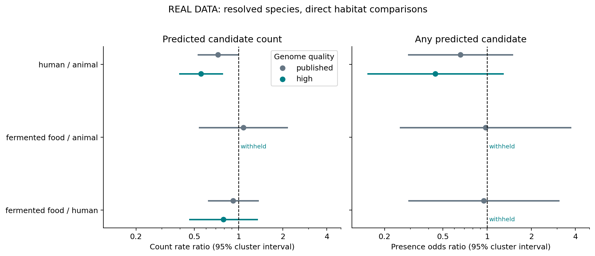

# Corrected ecology results and the next research lead — 21 October 2026

**The crude fermented-food advantage still fails the within-species checks. A
high-quality human/animal count difference survives the specified direct-pair
controls, but remains an exploratory lead with incomplete ancestry, composition
and screening controls.** It does not establish measured antimicrobial activity.

## Correction of our earlier analysis

The source table uses only `s__` for 20 genomes spanning six genera and all three
habitats. This is an unresolved species rank, not a common species assignment.
Our earlier notebook 05 pooled that label in species effects and cluster covariance.
That was inappropriate. The original data and fits remain frozen and labeled
historical; the correction excludes those assignments from species-based inference,
without assigning missing species by genus. It does not assert that the source
paper treated them as one biological species.

The complete screened registry still has 1,964 genomes. There are 1,944 genomes
with 136 resolved species labels; the common informative joint-model cohort is
**1,292 genomes / 35 resolved species**. The 20 excluded assignments and every
model's exact membership are exported. Placeholder GTDB names such as `sp...`
are retained when they are specific labels, rather than bare ranks.

| Corrected food/human comparison | Genomes | Rate ratio | 95% cluster interval |
|---|---:|---:|---:|
| Crude resolved-label registry | 1,944 | 1.89 | 1.19–2.98 |
| Crude common informative cohort | 1,292 | 1.54 | 0.89–2.65 |
| Same cohort + species effects | 1,292 | 1.10 | 0.81–1.50 |
| Same cohort + genome size, quality and GC | 1,292 | 1.02 | 0.75–1.39 |

The qualitative conclusion survives the correction. Species sorting can itself
be ecological biology; conditioning on species asks a narrower within-lineage
question, and this change is not a causal decomposition or proof of predictor bias.

## Direct pairs and genome quality

Each pair retains only resolved species represented in both habitats. After
completeness >=90% and contamination <5% filtering, overlap is recomputed. All
count fits use species fixed effects, log genome size, completeness, contamination
and GC, with species-cluster sandwich t intervals. At least ten informative
species clusters are required; missing support is not reported as a null effect.

| Direct count comparison | Quality | Genomes / species | Rate ratio | 95% interval |
|---|---|---:|---:|---:|
| Human / animal | Published registry | 1,092 / 18 | 0.72 | 0.53–0.99 |
| Food / animal | Published registry | 209 / 14 | 1.08 | 0.54–2.14 |
| Food / human | Published registry | 234 / 17 | 0.92 | 0.62–1.36 |
| Human / animal | >=90% / <5% | 379 / 16 | 0.56 | 0.40–0.77 |
| Food / animal | >=90% / <5% | 35 / 9 | Withheld | Insufficient species support |
| Food / human | >=90% / <5% | 108 / 13 | 0.79 | 0.47–1.34 |

The high-quality human/animal count contrast has unadjusted p=0.00182 and
Holm p=0.00546 within its specified three-contrast family. The published-quality
human/animal result has unadjusted p=0.0435 but Holm p=0.131. These are exploratory
comparisons across distinct cohorts, not an independent replication or a claim
that quality filtering causes a stronger biological effect.



## Influence, presence and withholding

For the high-quality human/animal count model, dropping each of its 16 species
produces point estimates **0.53–0.63**. Fifteen of 16 unadjusted omission intervals
stay below 1. Excluding `s__Ligilactobacillus sp945923665` makes the interval reach
1; uncertainty is therefore not invariant to influential-species removal.
All 87 direct-count omissions, including nine that fall below the cluster gate,
and all 35 joint-model omissions are retained. No favorable omission is selected.

Binary presence is a separate endpoint with a different cohort. Its high-quality
human/animal odds ratio is **0.44 (0.15–1.28)** across 365 genomes / 13 species.
This is imprecise, not proof of no prevalence association or a count-specific
mechanism. The high-quality food/animal presence comparison has six species and
is withheld. The high-quality food/human presence fit is also withheld for
extreme/nonconverged coefficients. All 12 specifications, statuses, diagnostics,
Holm corrections and sample IDs are available in `examples/ecology-robustness/`.

## What survives, and what has not been tested adequately

The human/animal count association survives the tested **species-membership,
genome-size, completeness, contamination and genomic-GC controls** in the strict
quality subset. That is a useful candidate for further investigation. It has
**not** demonstrated independence from full strain phylogeny, whole-proteome
amino-acid composition, original-source study effects, clonality or exact screened
small-ORF opportunities. Species-cluster covariance does not correct dependence
between related species. GC is a composition proxy, not complete composition.

Macrel small-ORF counts remain distinct from encrypted APEX windows in reviewed
archaeal proteins. Candidate counts do not measure expression, proteolytic release,
experimental potency, host adaptation or AMR co-evolution. We have not pooled the
endpoints or claimed that all ecology disappears after adjustment.

The next decisive study should compare independently sourced, closely matched
human/animal strains using a real strain tree, full proteomes and an explicitly
uniform screen with known denominators. The archived ATB screen could enable
that and the resistance aim, but only with valid source/score/export provenance.
Our [deeper search and conditional scope audit](../atb-export-search-2026-10-21.md)
records the remaining gap and [precise data request](../atb-export-request-2026-10-21.md).

## Reproduction and provenance

Protocols were committed in stages before the corresponding analyses: initial
checks (`d5c1eac`), post-lead influence (`405ac97`), taxonomy correction (`78d5882`).
These are exploratory addenda, not a confirmatory preregistration. Original
source data are [Du et al.](https://doi.org/10.1186/s40168-025-02145-3), CC BY 4.0;
software licensing is separate.

```bash
python scripts/analyze_ecology_robustness.py \
  --data examples/lactobacillaceae-ecology --out runs/ecology-robustness
python scripts/audit_ecology_pair_influence.py \
  --data examples/lactobacillaceae-ecology --out runs/ecology-pair-influence
python scripts/execute_study_notebooks.py notebooks/06_real_ecology_robustness.ipynb
```

Notebook 06 reruns all new fits and influence analyses and compares them with
frozen artifacts; it does not substitute synthetic results. Source, script,
statistics, cohort and output hashes accompany the actual-data results.
