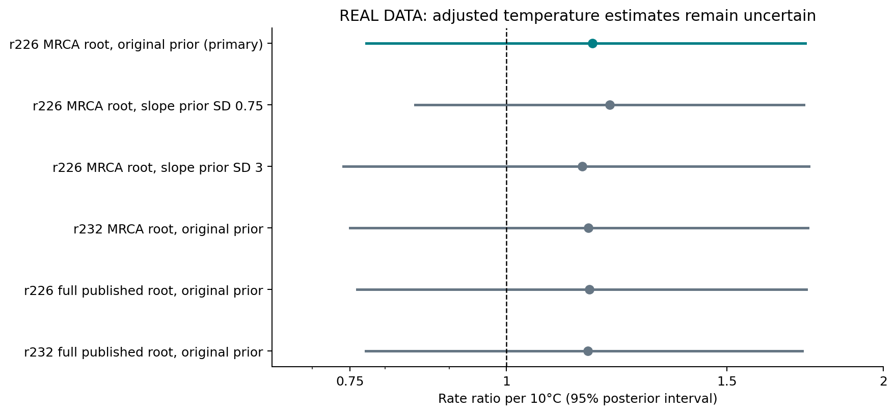

# First real comparative results

The pilot does **not establish a temperature association independent of the
included composition and ancestry controls**. The point estimate remains positive,
but its uncertainty is large. This is not evidence that temperature has no role,
and the coefficient change is not proof of model bias or causal mediation.

All estimates below use actual published outcomes and curated physiology, not the
simulated examples. The protocol was committed before fitting.

## Primary comparison on the same genomes

Twenty-nine complete genomes pass source, culture/QC and tree checks, with 8,308
verified historical parent sequences. Reported growth optima span 22.5–100.5 C.
Counts concern predicted positives in the matched reviewed-protein subset.

| Phylogenetic NB2 model | Genomes | Rate ratio per 10 C | 95% posterior interval |
|---|---:|---:|---:|
| Ancestry + proteome size + reviewed fraction | 29 | 1.34 | 1.05–1.69 |
| Add three screened-protein composition PCs (primary) | 29 | 1.17 | 0.77–1.73 |

The PCs account for about 85% of variation in screened-protein composition in
this cohort. Controlling them changes the association's estimate and precision;
this cannot distinguish true compositional thermoadaptation from prediction
bias. Inference is observational, with limited taxonomic coverage and small N.

## Prespecified sensitivities

| Composition-adjusted phylogenetic model | Genomes | Rate ratio per 10 C | 95% posterior interval |
|---|---:|---:|---:|
| At least 100 verified reviewed parents | 26 | 1.26 | 0.81–1.92 |
| Broader verified-parent coverage | 53 | 1.21 | 0.91–1.63 |
| Unflagged GenomeSPOT temperature | 26 | 1.04 | 0.57–1.97 |

All five final models pass the original diagnostics: zero divergences,
all-parameter Rhat <1.01 and bulk ESS >=400, using four chains with 4,000 retained
draws each. Earlier attempts with failed diagnostics are retained in a separate
ledger; none supplies the reported intervals. Posterior predictive checks and
per-genome predictions are exported, not replaced with simulation.

## Which parent proteins were screened?

Within-homology Poisson sensitivities use family fixed effects and two-way
cluster-robust uncertainty for genomes and homologous groups. These are separate
from the ancestry-adjusted genome model and use a per-parent outcome.

| Composition-adjusted homolog contrast | Parent rows | Groups | Rate ratio per 10 C | 95% cluster-robust interval |
|---|---:|---:|---:|---:|
| 30% identity / 80% bidirectional coverage | 2,021 | 159 | 1.23 | 1.04–1.47 |
| 50% identity / 80% bidirectional coverage | 774 | 85 | 1.16 | 0.98–1.38 |

Both use the same 29 genomes but different family/parent sets. The narrower
homology comparison does not resolve the interval away from no association.
Do not select the more favorable definition or treat secondary raw p-values as
confirmatory discoveries. Strong overdispersion (about 8–10) reinforces the need
for robust uncertainty and additional biological replication.

## Exploratory prior, release and root checks

Five additional four-chain fits use the same 29 genomes and original final
sampling settings. All pass the same all-parameter diagnostic gates, with zero
divergences, maximum Rhat <1.003 and minimum bulk ESS >2,200.

| Exploratory adjusted specification | RR per 10 C | 95% posterior interval |
|---|---:|---:|
| r226 MRCA root; non-intercept prior SD 0.75 | 1.21 | 0.85–1.73 |
| r226 MRCA root; non-intercept prior SD 3 | 1.15 | 0.74–1.74 |
| r232 retained-MRCA root; original priors | 1.16 | 0.75–1.74 |
| r226 full published root; original priors | 1.16 | 0.76–1.74 |
| r232 full published root; original priors | 1.16 | 0.77–1.72 |

The original pruning removed the shared stem above the retained genomes' MRCA.
It preserves patristic distances and clade orientation but not the full published
root-to-tip depths. This corrects earlier rooting prose in the original protocol
and source provenance; neither those original records nor fits were silently
rewritten. Removed stems were 0.04572 (r226) and 0.14953935 (r232) substitutions/site.
The two additional published-root fits preserve both stems and root depths,
verified against the raw trees. The addenda were committed before their fits.

The tested shrinkage/release/root choices leave the adjusted result uncertain;
this is neither a proof of equivalence nor an exhaustive model-robustness claim.

## What is new enough to pursue?

The candidate contribution is an auditable test of whether ecological physiology
adds information beyond source sampling, composition and ancestry in encrypted-
AMP mining. Habitat associations and extremophile AMP discovery already exist.
The code/data/provenance make that distinction testable; this pilot does not
establish publication priority or a new antimicrobial mechanism.

The next decisive evidence is an independently sampled, uniformly screened cohort
and adequate power, followed by activity validation for functional claims. The
limited prior/tree/root sensitivities above are now complete. A separate
[bacterial ecology comparison](../ecology-comparison/robustness-results-2026-10-21.md) shows how
species and genome covariates change habitat estimates, but its small-ORF
endpoint cannot replicate temperature-associated encrypted fragments.
The AllTheBacteria resistance question still needs the complete original
sample/parent/fragment score export and clarification of its threshold. A 24-peptide
synthesis shortlist cannot supply that cohort.
